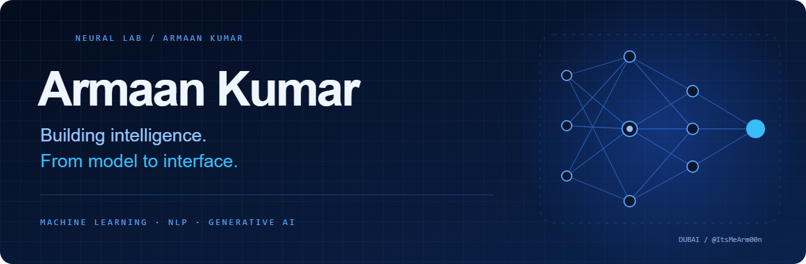

<div align="center">

**AI developer · Research-minded builder · Dubai, UAE**

I turn data, models, and messy real-world questions into applications people can explore.

[Portfolio](https://armaan-ai.vercel.app) &nbsp; / &nbsp; [LinkedIn](https://www.linkedin.com/in/armaan-kumar-631868343/) &nbsp; / &nbsp; [Hugging Face](https://huggingface.co/ItsMeArm00n) &nbsp; / &nbsp; [ORCID](https://orcid.org/0009-0000-1543-3595) &nbsp; / &nbsp; [Email](mailto:armaan27armaan@gmail.com)

</div>

---

### 01 / Intelligence starts with a question

Can environmental data help us understand the air we breathe? Can language models make career exploration more personal? Can a model become an interface that someone actually wants to use?

These are the kinds of questions I build around. My work spans **machine learning, natural language processing, generative AI, and full-stack development**, with projects in education, environmental monitoring, health, and market intelligence.

I enjoy the whole process: understanding the data, choosing a model, evaluating its limits, building an API, and designing the experience around it.

### 02 / The model-to-interface collection

<table>
<tr>
<td width="50%" valign="top">

#### ↗ CareerSim AI
**Education × generative AI**

Career exploration from academic profiles: simulated trajectories, personalized roadmaps, stream selection, and ROI analysis. Gemini outputs structured JSON for the application experience.

`Next.js` `TypeScript` `Gemini API` `Tailwind CSS`

[Explore application →](https://careersim-ai.vercel.app)

</td>
<td width="50%" valign="top">

#### ↗ NexGen AI
**Market intelligence × structured generation**

A dashboard for competitor analysis and customer insights, turning AI-generated information into structured data and visualizations.

`Next.js` `TypeScript` `Gemini API` `PostgreSQL`

[Explore application →](https://nexgen-ai-pro.vercel.app)

</td>
</tr>
<tr>
<td valign="top">

#### ↗ AQIntel
**Environmental data × machine learning**

Air quality classification and AQI regression from pollutant and meteorological inputs, with models served through a FastAPI wrapper on Hugging Face.

`Python` `Random Forest` `scikit-learn` `FastAPI`

[Application](https://aqintel.netlify.app) · [Source](https://github.com/ItsMeArm00n/Aqintel)

</td>
<td valign="top">

#### ↗ BhāvSense AI
**Hindi language × sentiment analysis**

A sentiment analysis interface focused on Hindi social media text, exploring language technology beyond English.

`Python` `Logistic Regression` `FastAPI` `Next.js`

[Application](https://bhavsense-ai.vercel.app) · [Source](https://github.com/ItsMeArm00n/Bhavsense)

</td>
</tr>
<tr>
<td valign="top">

#### ↗ MedRisk AI
**Patient vitals × risk classification**

A machine learning prototype exploring risk categories from respiratory, cardiovascular, and neurological inputs. Built for experimentation, not clinical decision-making.

`Python` `XGBoost` `Pandas` `FastAPI`

[Application](https://med-risk-ai.vercel.app) · [Source](https://github.com/ItsMeArm00n/med-risk-ai)

</td>
<td valign="top">

#### ↗ PoliTruth AI
**News text × NLP classification**

An experimental news classifier using text preprocessing and a Passive Aggressive model to explore patterns associated with misinformation. Predictions are model outputs, not fact checks.

`Python` `NLTK` `scikit-learn` `Next.js`

[Application](https://politruth-ai.vercel.app) · [Source](https://github.com/ItsMeArm00n/PoliTruth-AI)

</td>
</tr>
</table>

### 03 / Beyond the repository

| Milestone | Work behind it |
| :--- | :--- |
| **1st place · Commit & Conquer** | Open-source hackathon with 400+ contributors |
| **National finalist · Quantathon, Shaastra** | Selected among the top six nationwide |
| **Finalist · TechSprint AI Hackathon** | Top 25 among 500+ participants |
| **3rd place · Innovista** | Eco Haven: autonomous plant systems, self-healing materials, and a plastic-collecting robot fish concept |
| **AI internship · Seed Paper India** | Research and development around sustainable production |
| **AI internship · Miracle Print Advertising** | Employee training on AI automation and business workflows |

**Research:** *AQIntel: Machine Learning-Based Air Quality Index Prediction* explores Random Forest models for AQI prediction using pollutant and meteorological data. [Publication details on my portfolio →](https://armaan-ai.vercel.app)

### 04 / The intelligence stack

```text
MODEL       Python · scikit-learn · XGBoost · Pandas · NumPy
LANGUAGE    NLP · NLTK · Hugging Face · Gemini API
SERVE       FastAPI · Flask
INTERFACE   TypeScript · JavaScript · React · Next.js · Tailwind CSS
SHIP        Git · GitHub · Vercel · Netlify
```

<details>
<summary><b>Open the wider project archive</b></summary>

Work across sustainability, health, hardware concepts, and the web:

- [CareerForge AI](https://github.com/ItsMeArm00n/CareerForge-AI) — academic stream and career recommendations.
- [Eco-360](https://github.com/ItsMeArm00n/Eco-360) — sustainability platform.
- [Swasth-AI](https://github.com/ItsMeArm00n/Swasth-AI) — nutrition and health analysis prototype for India.
- [Bio-Haven](https://github.com/ItsMeArm00n/Bio-Haven) — bio-monitoring dashboard.
- [Project Riptied](https://github.com/ItsMeArm00n/Project-Riptied) — ocean cleanup robot-fish concept.
- [CS50P](https://github.com/ItsMeArm00n/CS50P) — Python coursework and practice.
- [All public repositories →](https://github.com/ItsMeArm00n?tab=repositories)

</details>

---

<div align="center">

**An interesting problem is a good reason to start a conversation.**

Open to AI research collaborations, hackathons, and thoughtful open-source projects.

[Let's build something →](mailto:armaan27armaan@gmail.com)

<sub>Armaan Kumar · @ItsMeArm00n · Dubai, UAE</sub>

</div>

